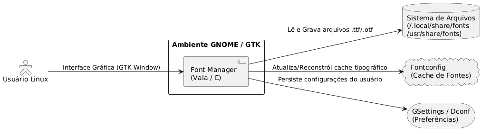
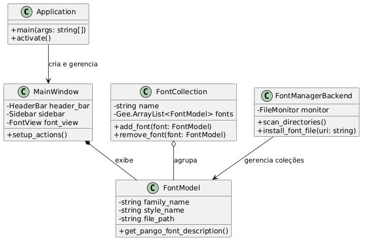
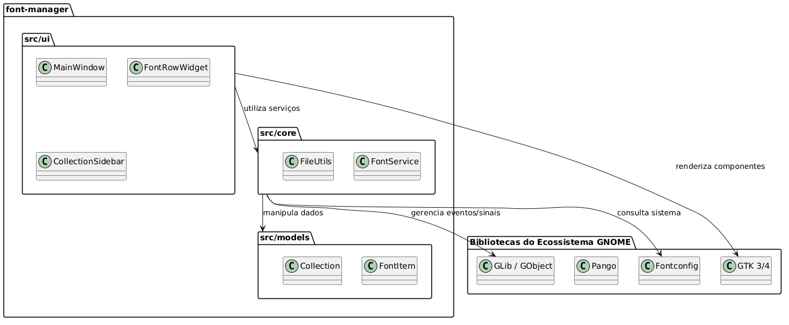
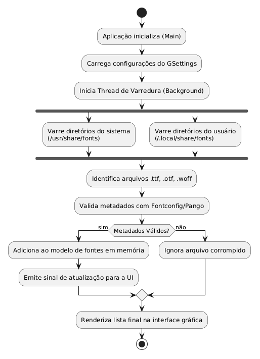
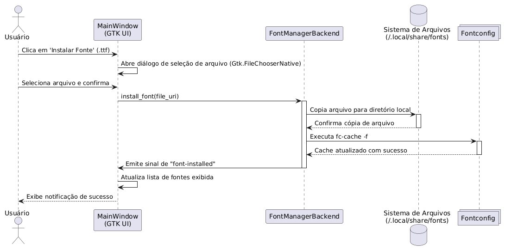

# 04. Modelagem UML e Compreensão do Sistema

Esta seção apresenta a modelagem UML do **Font Manager**, desenvolvida para representar a arquitetura e os fluxos do software original em Vala/C. Os diagramas foram modelados via PlantUML e estão referenciados a seguir, acompanhados pelo mapeamento explícito com a estrutura do código-fonte.

## 1. Diagrama de Contexto

O diagrama de contexto ilustra como o Font Manager interage com os principais subsistemas do ambiente operacional Linux e com o usuário final.

## 2. Diagrama de Classes

Representa os componentes estruturais do núcleo da aplicação, modelos de dados e a integração entre a camada de interface e os serviços de backend.

## 3. Diagrama de Pacotes

Exibe a organização dos módulos do código-fonte e o desacoplamento com as bibliotecas externas do ecossistema GNOME.

## 4. Diagrama de Atividades

Detalha o fluxo operacional de inicialização e varredura de arquivos de fontes no sistema pelo backend da aplicação.

## 5. Diagrama de Sequência

Modela a troca de mensagens síncronas e assíncronas entre os componentes do sistema durante a ação de instalação de uma nova fonte.

## 6. Mapeamento e Correspondências com o Código-Fonte

A tabela a seguir relaciona explicitamente os elementos representados nos diagramas UML com os arquivos e estruturas concretas encontradas no repositório oficial do projeto:

| Elemento no Diagrama UML | Elemento Concreto no Código-Fonte | Descrição da Correspondência |
| :--- | :--- | :--- |
| **Class `Application`** | `src/font-manager/main.vala` | Ponto de entrada da aplicação GTK (`Gtk.Application`), responsável por inicializar o ciclo de vida e a janela principal. |
| **Class `MainWindow`** | `src/font-manager/ui/Window.vala` | Classe principal da interface visual (`Gtk.ApplicationWindow`), agrupando componentes visuais como barras de busca e painéis. |
| **Class `FontManagerBackend`** | `src/lib/font-manager-core.vala` | Módulo de lógica de negócio responsável pela comunicação com o sistema de arquivos e atualização do cache do `fontconfig`. |
| **Package `src/ui`** | Diretório `src/font-manager/ui/` | Pasta contendo todas as definições de widgets, arquivos de template visual (`.ui`) e comportamentos da interface gráfica. |
| **Database `Fontconfig`** | Chamadas da biblioteca externa `libfontconfig` / `fc-cache` | Sistema nativo do SO responsável por indexar e fornecer acesso às fontes instaladas no ambiente Linux. |

